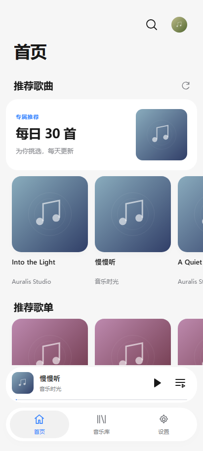
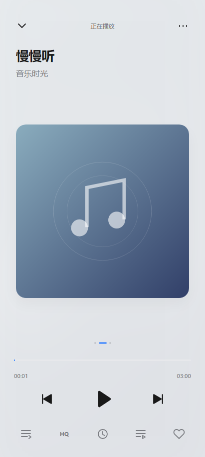
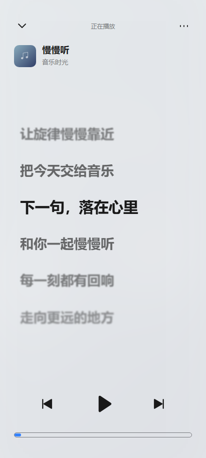
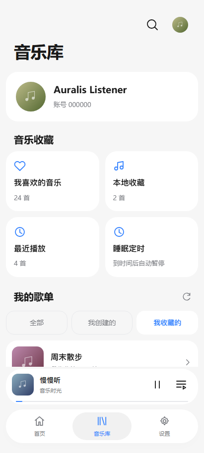

<div align="center">


**Rust × Android 音频应用学习项目 · 仅供学习与技术研究参考**

[](https://github.com/Memories-white/Auralis/releases/tag/v0.3.6) [](docs/BUILD.md) [](docs/BUILD.md) [](ui/README.md) [](LICENSE)

[下载安装](https://github.com/Memories-white/Auralis/releases/latest) · [使用指南](docs/USAGE.md) · [本地构建](docs/BUILD.md) · [更新日志](CHANGELOG.md) · [问题反馈](https://github.com/Memories-white/Auralis/issues)

</div>

## 关于 Auralis

最新修复预览：[0.3.9-preview](https://github.com/Memories-white/Auralis/releases/tag/v0.3.9-preview)。修复“猜你喜欢”内容为空，并支持关闭重开后恢复歌曲、队列与进度。验证范围见[设备记录](design/DEVICE_VALIDATION.md)。稳定版本仍为 0.3.6。

主分支包含 **0.4.4-preview 源码**：参考 Melox 的页面层次，使用 **Rust/WASM 重构界面布局、交互和歌词动效**，新增分组设置、三种底栏和歌词外观自定义。Android 保留主题取色、系统宿主与原有播放服务。构建、交互检查和实机范围见[验证记录](design/DEVICE_VALIDATION.md)；继续开发前请读 [AI 交接表](docs/HANDOFF.md)。当前已发布安装包仍为上面的 0.3.9-preview。

Auralis 是面向 Android 的音频应用学习项目，使用 **Rust** 实现界面及协议适配。界面模块编译为 WebAssembly，随 APK 离线打包，由 Android WebView 承载；Kotlin 负责平台桥接、业务状态与播放服务。原生 MIUIX 主题继续提供明暗与莫奈配色，页面布局由 Rust 独立实现。

项目处于持续迭代阶段，当前版本为 **0.3.6**。部分演示功能依赖外部服务及账号授权，受服务条款、地区和内容权益限制；本项目与任何第三方服务提供方均无隶属或官方合作关系。

> **学习与使用边界**：本仓库仅供学习、技术研究与代码参考。请仅在具有合法权限的范围内使用，不得用于未经授权的内容获取、传播或其他侵权行为。项目代码许可证不授予任何第三方服务、账号、商标或媒体内容的使用权。

## 界面一览

<table>
  <tr>
    <th width="25%">首页推荐</th>
    <th width="25%">封面播放器</th>
    <th width="25%">同步歌词</th>
    <th width="25%">音乐库</th>
  </tr>
  <tr>
    <td></td>
    <td></td>
    <td></td>
    <td></td>
  </tr>
</table>

以上为 **0.4.0-preview 实际 Rust/WASM 渲染截图**，使用自动化检查夹具与本项目绘制的占位封面，不包含真实账号资料。实机加载、播放与歌词验证单独记录，不将测试数据当成服务返回结果。

## 主要功能

| 模块 | 当前能力 |
| :-- | :-- |
| **发现音乐** | 每日 30 首独立入口、个性化歌曲分页流、排除每日与已展示歌曲、返回顶部 |
| **搜索** | 歌曲搜索、推荐歌手与歌曲、最近 8 条搜索记录、一键清空历史 |
| **我的音乐** | 账号头像与昵称、喜欢、自建与收藏歌单、本地收藏、添加歌曲到云端喜欢 / 自建歌单；预览版新增最近播放 |
| **播放** | 播放队列、上一首 / 下一首、暂停、进度拖动、后台播放与媒体通知 |
| **播放顺序** | 顺序、列表循环、单曲循环、随机；随机模式记录实际播放历史 |
| **音质** | 自动、SQ 无损、HQ 高品质、标准；可选择是否允许降级，显示实际获取档位 |
| **同步歌词** | 原文与翻译、当前句放大回弹、逐行错峰移动、按距离渐进模糊、手动浏览后恢复跟随 |
| **外观** | 跟随系统 / 浅色 / 深色；系统壁纸、封面或自定义莫奈色源，10 种色板 |
| **图片缓存** | WebP 磁盘缓存上限 24 MB / 240 项，内存上限 8 MiB，支持过期缓存离线回退 |
| **系统歌词** | 通过 MediaSession 发布歌词，配合适配版 LyriconProvider 与兼容消费端使用 |
| **睡眠定时（预览）** | 15 / 30 / 60 / 90 分钟后暂停，或播完当前歌曲后暂停；在播放服务中计时 |
| **恢复播放（预览）** | 保存最后歌曲、最多 500 首队列及播放进度，重开后默认暂停，点击播放重新获取音源并续播 |

### 0.3.9-preview 修复

- “猜你喜欢”使用专属推荐接口加载真实歌曲，显示歌曲封面和实际数量。
- 关闭进程后，底部歌曲栏恢复最后歌曲与进度；后台仍在运行时优先显示实际播放会话。
- 播放中约每 5 秒保存进度，暂停、完成拖动和正常停止时立即保存。首次从旧版升级可用最近播放补回曲目信息，旧版未保存的进度从 0 开始。

[下载修复预览版](https://github.com/Memories-white/Auralis/releases/tag/v0.3.9-preview) · [查看实机验证](design/DEVICE_VALIDATION.md)

### 0.3.8-preview 新变化

- 音乐库改为账号卡、四个收藏 / 工具入口、最近播放预览与轻量歌单列表。
- 歌单头部显示封面、已加载数量、播放全部和随机播放；完整播放器重新安排封面、歌曲信息与主要控制。
- 最近播放仅保存本机最多 100 首歌曲元数据，成功开始播放后记录；可以通过确认框清空。
- 睡眠定时可从播放页时钟按钮、「我的」或封面选项打开。停止播放服务或结束应用进程后取消。

预览安装包与完整说明：[0.3.8-preview Release](https://github.com/Memories-white/Auralis/releases/tag/v0.3.8-preview)。

### 0.3.6 新变化

新增 A 形播放标志，接入自适应桌面图标、圆形图标、单色主题图标及媒体通知标识。[查看图标设计与源文件](docs/ICON.md)。

### 0.3.5 功能回顾

- 移除顶部重复的每日 30 首入口，发现歌曲改用 个性化推荐流，持续向下加载，排除每日歌单和已展示歌曲。
- 首页与歌单增加返回顶部，歌单可定位当前播放歌曲。
- 点击封面打开约半屏的歌曲选项，包含音质、云端我的喜欢和自建歌单选择。
- 封面右滑进入歌曲信息，左滑仍进入同步歌词。
完整版本记录见 [CHANGELOG](CHANGELOG.md)。

## 安装与开始使用

1. 前往 [Releases](https://github.com/Memories-white/Auralis/releases/latest) 下载 `Auralis-v0.3.6-miuix-debug.apk`。
2. 使用 **Android 8.0+、arm64-v8a** 设备安装；按系统提示授权通知，以便使用后台媒体控制。
3. 使用手机 客户端扫码登录，进入首页刷新每日推荐，或打开搜索寻找歌曲。
4. 点击底部歌曲信息打开完整播放器；向左滑动封面进入歌词页。

> 当前提供开发签名 APK。不同签名的安装包不能直接覆盖安装；操作前请确认数据处理方式。下载页附有 SHA256 校验文件。

## 播放与歌词

音质入口位于播放页的音质按钮，以及「设置 → 播放 → 音质」。手动切换音质会保留当前播放位置与暂停状态，请求失败时保留已有音源。播放顺序通过播放页左下角图标切换。

系统歌词需要带有 **`dev.qqlyric.app → Auralis`** 适配的 LyriconProvider；仅安装原始 Provider 并不代表已经支持本应用。当前使用逐行 LRC，动画不会生成源数据里不存在的逐字时间轴。配置与验证范围见 [使用指南](docs/USAGE.md#系统歌词) 和 [Lyricon 联调记录](design/LYRICON_VALIDATION.md)。

## 构建与项目结构

```text
Auralis/
├── core/                 Rust 协议、数据归一化、音源与歌词
├── ui/                   Rust/WASM 页面、交互、动效与本机文档入口
├── android/              WebView / 主题桥接、播放服务、MediaSession
├── tools/                播放顺序、缓存等本地检查
├── docs/                 使用、构建、架构、截图及许可说明
├── design/               设计决策与实机验证记录
└── build.ps1             Windows Rust + Android 完整构建入口
```

准备 JDK 21、Rust Android / WASM target、wasm-bindgen-cli 0.2.108、Android SDK 37.2 和 NDK 27+ 后，在项目根目录运行：

```powershell
rustup target add aarch64-linux-android
.\build.ps1
```

脚本先构建 Rust/WASM 界面和 Rust 动态库，再打包 Android APK。首次构建需联网获取依赖；离线构建、工具链版本与测试命令见 [构建指南](docs/BUILD.md)。生成的模块、动态库、APK、账号数据及本机 SDK 配置均不提交到源码仓库。

## 当前限制

- 喜欢列表与单个歌单目前读取前 **100 首**，尚未实现分页。
- 暂未实现下载、歌单创建 / 删除 / 排序、登录凭据自动续期；登录过期后需要重新扫码。
- 播放与音质取决于账号、地区和曲目实际授权，**不绕过会员或版权限制**。
- 实机验证以 Redmi K60 当前系统为主，未完成平板及全部 Android / ROM 组合验证。
- 使用 MIUIX 设计语言；应用动画并非 HyperOS 私有转场的逐帧复刻。顶栏采用不透明语义色，歌词保留独立模糊效果。

## 文档导航

| 文档 | 内容 |
| :-- | :-- |
| [使用指南](docs/USAGE.md) | 登录、发现、音质、歌词、外观和常见问题 |
| [构建指南](docs/BUILD.md) | 工具链、Rust / JNI 构建、检查和产物 |
| [架构说明](docs/ARCHITECTURE.md) | 协议、界面、服务、数据与系统歌词边界 |
| [设计说明](design/DESIGN.md) | 页面组织、动效和进度条的设计决策 |
| [实机验证](design/DEVICE_VALIDATION.md) | 各版本实际检查、测试证据与未覆盖范围 |
| [贡献指南](CONTRIBUTING.md) | 开发与反馈约定 |
| [安全说明](SECURITY.md) | 凭据处理与问题报告 |
| [第三方说明](docs/THIRD_PARTY.md) | 致谢、许可证与素材归属 |

## 致谢与许可

- [MIUIX](https://github.com/compose-miuix-ui/miuix)：原生主题、莫奈取色和设计规范。
- [Melox](https://github.com/Inefy-03/Melox)：0.4 界面结构与交互研究参考，按 Rust 要求独立实现。
- [Melodist](https://github.com/Viemean/melodist)：账号登录 / API 调用研究与首页布局参考。
- [LyriconProvider](https://github.com/limczhh/LyriconProvider)：系统歌词适配与发布链路参考。
- Rust、Jetpack Compose 及其他依赖的贡献者。

项目代码采用 [MIT License](LICENSE)，第三方组件保留其各自许可证。音乐服务、商标、歌曲、歌词和封面等内容不属于本项目的代码许可范围。详情见 [第三方说明](docs/THIRD_PARTY.md)。
