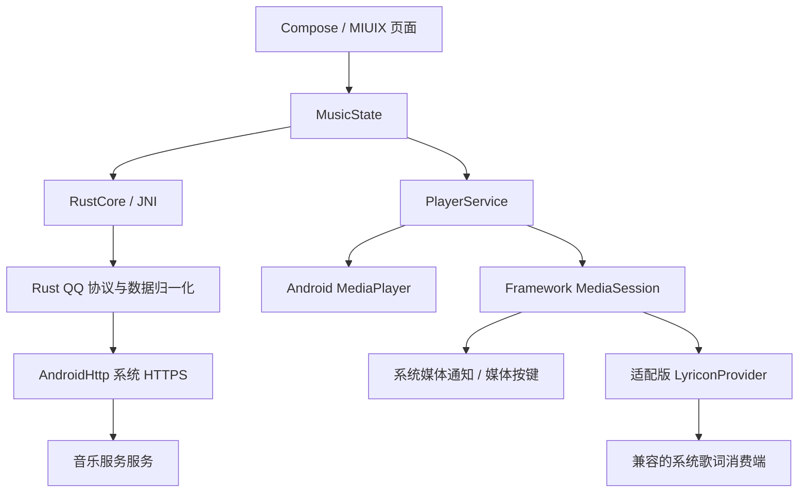

# 架构说明

[← 返回首页](../README.md) · [构建指南](BUILD.md) · [设计决策](../design/DESIGN.md)

## 数据与播放链路

Rust 负责请求参数、响应解析、登录状态、曲库、搜索、授权播放地址与歌词数据。Android 网络适配器提供系统 DNS / 代理 / TLS 通道，播放器负责流式播放授权地址。

## 模块边界

| 位置 | 责任 |
| :-- | :-- |
| `core/src/lib.rs` | 服务接口、数据模型归一化、音质候选与响应选择、JNI 入口 |
| `core/src/discovery.rs` | 个性化歌曲货架分页、每日 / 已展示排除、云端添加及成员核对 |
| `core/src/android_http.rs` | Rust 到 Android HTTPS 的桥接 |
| `MusicState.kt` | 页面业务状态、账号、异步结果、队列与偏好 |
| `MainActivity.kt` | 唯一主题、页面宿主、导航、弹层、歌曲栏与完整播放器 |
| `DiscoveryContent.kt` | 首页与搜索的列表内容，复用宿主滚动和 inset |
| `PlayerService.kt` | 后台播放、媒体会话、音质重载与播放状态快照 |
| `SynchronizedLyrics.kt` | 播放定位、手动浏览恢复、逐行位移 / 缩放 / 模糊 |
| `ThinSeekBar.kt` | 播放进度绘制、拖动、键盘及无障碍控制 |
| `PlaybackOrder.java` | 顺序、循环和随机遍历 / 历史，不依赖网络 |
| `MonetAppearance.kt` | MIUIX 主题控制器、色源与色板 |
| `ArtworkCache.kt` / `ArtworkDiskStore.java` | 有界内存与 WebP 磁盘缓存 |
| `SecureStore.kt` | Android Keystore 加密凭据存储 |

仓库保留部分早期 View 辅助类用于历史实现参考，当前 Manifest 主入口为 Compose `MainActivity`；不要据此判断当前仍提供多套主题。

## 一致性与生命周期

- 歌曲选择使用独立请求标识，服务通过原子快照发布播放状态，防止旧歌词或音源覆盖新选择。
- 搜索、歌单和登录拥有独立代次检查；搜索结果与歌单条目分别保存。
- 音质切换成功后按回调时的位置和暂停状态重建音源，失败保留当前播放；旧请求不会覆盖更新的选择。
- 系统歌词发布歌曲身份、原文、翻译和播放时间戳；协议层能力与消费端显示策略分开验证。
- 个性化推荐在独立线程执行，页码单调推进，失败等待重试；云端写入区分服务受理与成员确认。
- 凭据保存在应用私有存储并加密，图片缓存与收藏等普通偏好分开管理。

## UI 与动效

单一 `MiuixTheme` 管理明暗与莫奈色。页面宿主负责系统栏、底栏和滚动，不在每个内容模块重复创建 Scaffold。完整播放器从歌曲栏位置展开；歌曲栏自身使用同一动画进度协调高度、封面和唯一进度轨道。

歌词使用 lazy 布局与逐行 FLIP 位移，保留可打断的弹簧速度；清晰焦点、渐进模糊与视口渐隐分别处理。遵循系统动画时长设置，不伪造逐字时间轴。

详细参数、设备绘制回退和各版本实测范围分别记录于 [设计说明](../design/DESIGN.md) 与 [设备验证](../design/DEVICE_VALIDATION.md)。
