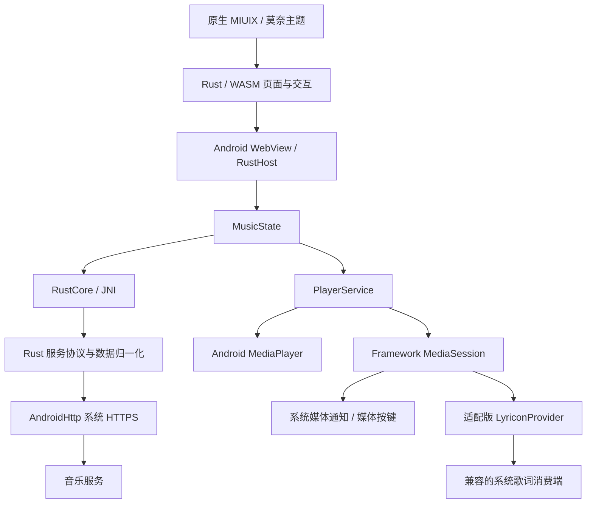

# 架构说明

[← 返回首页](../README.md) · [构建指南](BUILD.md) · [Rust UI](../ui/README.md)

## 数据与播放链路

Rust UI crate 负责页面、事件和动效，core crate 继续负责协议、登录、曲库、搜索、授权播放地址与歌词。Android 提供系统 DNS / 代理 / TLS 通道和播放服务。0.4 UI 重构没有重写协议或播放服务。

## 模块边界

| 位置 | 责任 |
| :-- | :-- |
| `ui/src/presentation.rs` | 页面层次、分组、内容顺序、设置依赖及操作描述 |
| `ui/src/render.rs` / `style.css` | Rust DOM 构建、视觉样式、播放器与弹层 |
| `ui/src/lib.rs` | 点击、键盘、手势、页面滚动、底栏胶囊 / 歌曲栏 / 播放器共享元素、歌词弹簧与瞬时 UI 状态 |
| `ui/src/motion.rs` | 闭式解弹簧与插值；自定义轨迹统一按 `dt` 采样，可中途反向且与帧率无关 |
| `ui/src/labels.rs` | 字符串复用、参数格式化及外部内容转义 |
| `MainActivity.kt` | Android 生命周期与媒体通知打开播放器的入口 |
| `RustWebView.kt` | 本机资源、状态快照、业务动作及窗口 / 主题桥接 |
| `MusicState.kt` | 原有业务状态、账号、异步结果、队列与偏好 |
| `core/src/lib.rs` | 服务接口、模型归一化、音质响应选择与 JNI |
| `core/src/discovery.rs` | 推荐分页、每日排除、云端添加与成员核对 |
| `core/src/android_http.rs` | Rust 到 Android HTTPS 的桥接 |
| `PlayerService.kt` | 后台播放、媒体会话、音质重载及原子状态快照 |
| `PlaybackStore.kt` / `ListeningHistory.kt` | 有界队列 / 进度恢复与本机最近播放 |
| `PlaybackOrder.java` / `SleepTimer.java` | 播放顺序与单调时钟定时状态机 |
| `MonetAppearance.kt` | MIUIX 主题控制器、色源与色板 |
| `ArtworkCache.kt` / `ArtworkDiskStore.java` | 有界内存与 WebP 磁盘缓存 |
| `SecureStore.kt` | Android Keystore 加密凭据存储 |

原 Kotlin 页面和历史 View 界面已移除。Compose 仅在宿主边界解析现有主题与窗口信息；实际页面由 Rust/WASM 构建，没有并行的旧页面或第二个播放服务。

## 状态与生命周期

- 现有 MusicState 保持业务与导航状态所有权。Rust 中的筛选、弹层、手势与动画状态不复制账号或播放服务。
- 歌曲、搜索、歌单和登录使用各自请求代次；迟到结果不能覆盖新选择。歌单保持立即进入、页内加载 / 错误 / 重试，普通歌单和专属推荐保留各自协议入口。
- 音质切换成功后按回调时的位置和暂停状态重建音源，失败保留当前播放。播放服务继续发布系统歌词、媒体通知和会话令牌。
- 最近播放只在音频成功开始后记录，最多 100 首。恢复记录采用白名单元数据、最多 500 首队列与进度，不保存授权音源或凭据；冷启动默认暂停，后台有效服务状态优先。
- 睡眠定时只由服务持有，以 elapsedRealtime 计时；当前曲目结束模式先于循环和自动下一首，取消尚未完成的切歌请求。定时不跨进程保存。
- UI 结构性数据变化才重绘页面，播放进度使用轻量消息。歌单先取 100 首并显示服务端总数，接近底部继续取下一页并按批次展开，定位当前歌曲会先展开对应区域；"播放全部 / 随机播放"会先补齐整张歌单再入队。
- 生命周期暂停时停止 UI 采样与 WebView 计时；旋转在同一宿主实例内适配，保持当前页。系统栏、IME、横向 cutout 与内容安全区由宿主交接。

## 界面与资源边界

单一 MiuixTheme 管理明暗与莫奈色，通过语义颜色传给 Rust UI。Rust 管理顶栏、底栏、页面滚动和宽屏侧边导航。完整播放器以歌曲栏真实矩形作为展开 / 收回起点；歌曲栏保留一条随高度移动的进度轨道。

歌词按播放毫秒定位，Rust 帧时钟短程插值。切句或尺寸改变时统一测量并重排，通过可见行的独立解析弹簧补偿位移，CSS 完成当前句缩放、按距离渐进模糊和视口渐隐；不在每帧测量整首歌词。手动浏览结束后约 1.8 秒恢复跟随；系统关闭动画时直接定位，不伪造逐字时间轴。

播放器展开的容器裁剪、共享封面位置与正文显现由 Rust 同一进度控制，文字保持正常字号。几何策略参考 Melox 的播放器结构，由 Rust 独立实现，没有移植其无独立 Apache 标记的播放器文件。Android 高刷新率 API 仅为系统偏好桥接，实际刷新由系统和 WebView 决定。

WebView 仅加载 APK 内的本机 HTTPS 资源映射，禁止远程导航和直接联网。UI 接收必要元数据及状态，不接收 Cookie、音乐密钥或授权音源；封面继续走原有缓存。内容和属性经过转义，生成绑定与启动胶水不包含页面交互实现。

本次以 Rust UI 为明确要求，因此参考 MIUIX / Melox 的视觉结构，独立实现页面与控件；原生 MIUIX 库仅提供主题能力，没有将自绘页面描述为库内原生组件。

实测与未覆盖范围见[设备记录](../design/DEVICE_VALIDATION.md)。
