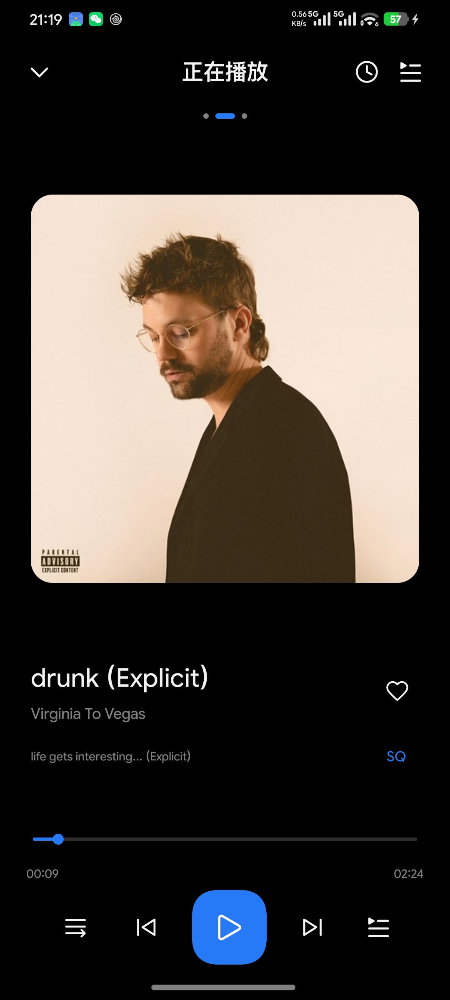

# Auralis 0.3.8-preview · 音乐库与听歌工具

> 仅供学习、技术研究与代码参考。请遵守账号、内容授权及第三方服务条款。

这一版继续统一 MIUIX 界面，重点整理音乐库、歌单与封面播放器，并新增两个本机听歌工具。

| 变化 | 使用方式 |
| :-- | :-- |
| 音乐库 | 紧凑账号卡、四个收藏 / 工具入口、最近歌曲预览及轻量歌单行 |
| 歌单概览 | 封面、已加载数量、播放全部和随机播放 |
| 封面播放器 | 重新安排封面与歌曲信息，加入分页指示，修正顶栏右侧按钮缺失 |
| 最近播放 | 「我的 → 最近播放」，最多 100 首，成功开始播放后记录，可确认清空 |
| 睡眠定时 | 播放页时钟、「我的」或封面菜单，15 / 30 / 60 / 90 分钟或歌曲结束后暂停 |
| 登录网络恢复 | 查询登录状态遇到 DNS / 超时错误时最多重试三次，重取二维码后旧查询失效 |

最近记录只存本机歌曲元数据，不含登录凭据或音源地址。定时由播放服务维护，退出播放页面后继续；服务停止、进程结束或设备重启后取消。暂停期间倒计时继续，“歌曲结束后暂停”优先于自动下一首及循环。

## 验证范围

- Rust 14 项单元测试与播放顺序、图片缓存、封面取色、睡眠定时四组 JVM 检查通过。
- Redmi K60 保留数据覆盖安装，检查音乐库、歌单、播放页及定时面板。
- 使用生成的本地静音 WAV，实测成功播放记录、恢复去重、歌曲结束时阻止循环、真实一分钟到期暂停；最近记录的取消 / 确认清空流程通过。
- 用户重新扫码登录后，真实曲目成功获取 SQ 音源，封面、持续播放进度、歌词分页、最近记录及定时面板已检查。未重复全部音质与系统歌词消费端的回归。
- 未完成全部 ROM、平板、大字体及深度休眠唤醒精度验证；未量化动画帧率。



## 安装

Android 8.0+ / arm64-v8a，开发签名；同签名旧版可保留数据覆盖安装。APK 与 SHA256 校验文件见本 Release 附件。

大小：18,508,723 bytes。SHA256：

```text
4c20ee0464cd38cd0692b15e4ec1f69a58d9318f7b7cd58ffdd8cf4910abc81d
```

签名、16 KB zipalign 和手机安装包回读哈希校验均已通过。

详细操作见[使用指南](https://github.com/Memories-white/Auralis/blob/main/docs/USAGE.md)，证据与限制见[设备验证](https://github.com/Memories-white/Auralis/blob/main/design/DEVICE_VALIDATION.md)。稳定版仍为 0.3.6，本版为预览。
