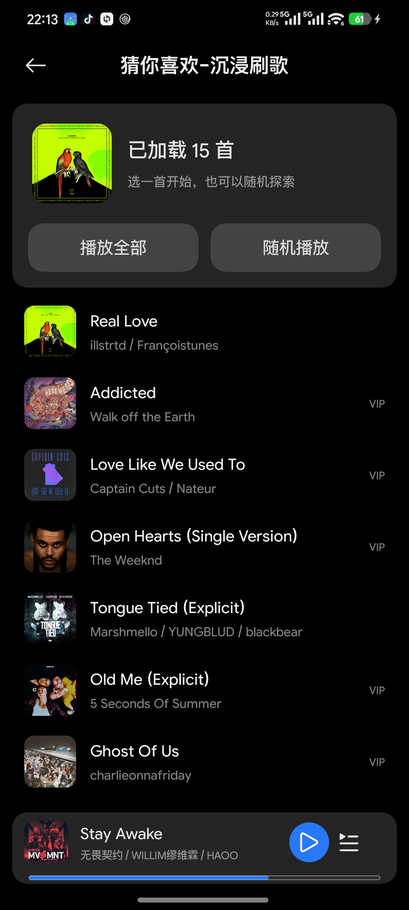

# Auralis 0.3.9-preview · 推荐与播放恢复修复

> 仅供学习、技术研究与代码参考，请遵守账号与内容授权边界。

- 修复首页“猜你喜欢”内容为空：专属推荐按正确接口读取，展示真实曲目、封面和数量。
- 底部歌曲栏恢复上次歌曲：保存最后歌曲、队列位置与进度，关闭进程后重开默认暂停，点击播放从保存位置续播。
- 后台正在运行时使用真实会话；播放恢复会重新获取有效音源，元数据和进度记录不包含登录凭据或授权音源地址。
- 播放中约每 5 秒保存，暂停、完成拖动及正常停止时立即保存，队列最多保存当前歌曲附近 500 首。旧版首次升级可补回最近曲目，旧版未保存的进度从 0 开始。

## 实机验证

- Redmi K60 保留数据覆盖安装 code 19；Rust 15 项、四组 JVM 检查及 Android 恢复 / 播放 / 睡眠检查通过。
- “猜你喜欢”实际显示 15 首与真实封面，首曲 Real Love 可以播放，暂停位置为 4.361 秒。
- Stay Awake 在 95.788 秒暂停，强制结束进程后重开仍显示相同歌曲和 01:35，默认暂停；点击播放后重新获取音源，继续前进至 100.696 秒。
- 未重复全部音质、系统歌词消费端、全部 ROM 与大屏 / 大字体组合验证。



## 安装包

Android 8.0+ / arm64-v8a，开发签名。`Auralis-v0.3.9-preview.apk`，17,595,639 bytes。

SHA256：

```text
20230e60cae760f6a7b7064988ba67a418f60f1173bb2d10ab4a1e77b0823d9b
```

APK 签名、16 KB ZIP / ELF 对齐和手机安装包回读哈希检查通过。

详细说明见[使用指南](https://github.com/Memories-white/Auralis/blob/main/docs/USAGE.md)与[设备验证](https://github.com/Memories-white/Auralis/blob/main/design/DEVICE_VALIDATION.md)。本版为预览，稳定版仍为 0.3.6。
